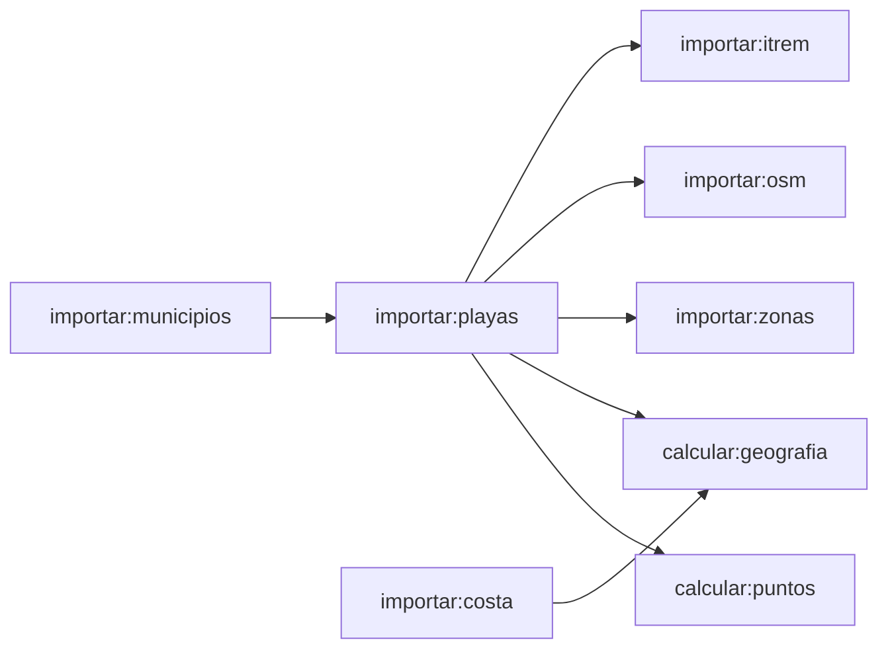

# Orientación, abrigo y laguna

Cada playa tiene tres datos geográficos que deciden cómo le afecta el tiempo: **hacia dónde mira** (`mira`), **cuánto la protegen** cabos y bahías (`abrigo`) y **si está en el Mar Menor** (`laguna`). No vienen de ninguna fuente oficial: se calculan con la línea de costa de OpenStreetMap. Este documento explica cómo, por qué el resultado es fiable y dónde no lo es.

- Código: `packages/core/src/orientacion.ts` y `abrigo.ts` (funciones puras) y `jobs/src/geografia-playas.ts` (consultas espaciales y guardado).
- Se calcula con `pnpm --filter @playa-hoy/jobs calcular:geografia`.

## El dato de partida: la costa tiene sentido

En OpenStreetMap, la línea de costa (`natural=coastline`) se dibuja siempre con **la tierra a la izquierda y el mar a la derecha**. Gracias a esa convención, la línea dice por sí sola a qué lado está el mar, sin tener que adivinarlo. Por eso la tabla `costa` guarda cada tramo con sus puntos en el orden original.

La costa descargada cubre la Región con algo de margen (37,30-37,95 N, 1,85-0,60 O) e **incluye la orilla del Mar Menor**: son 263 tramos y 15.550 puntos. Las 83 playas tienen la costa a menos de 50 m.

## Orientación (`mira`)

Rumbo en grados hacia el mar: 0 es norte, 90 este, 180 sur y 270 oeste.

1. Se pasan las coordenadas a metros, en un plano local centrado en la playa. A pocos cientos de metros, el error de suponer la Tierra plana es despreciable.
2. Se busca el **punto de costa más cercano** a la playa. Si está a más de 500 m, no se calcula: la orientación queda en `null`.
3. Desde ese punto se **recorre la costa 150 m hacia cada lado**, saltando de un tramo de OSM al siguiente por sus extremos comunes, y se suman los vectores de los segmentos en el sentido de la línea. Los tramos largos pesan más, lo que suaviza los picos de una costa irregular.
4. La perpendicular **por la derecha** de esa dirección media es hacia donde mira la playa.

Además se obtiene una **confianza** de 0 a 1: el largo del vector suma dividido por el largo recorrido. Es 1 en una costa recta y baja cuando la orilla gira junto a la playa, como en una cala o una punta.

### Por qué se recorre la costa y no un radio

La primera versión sumaba todos los segmentos a menos de 300 m de la playa. En La Manga, que es una franja estrecha, eso mezclaba la orilla del Mediterráneo con la del Mar Menor, dibujada en sentido contrario, y las dos se anulaban: El Galán salía mirando al oeste y Cabo de Palos con confianza 0,08. Recorrer la línea desde el punto más cercano resuelve el problema, porque la orilla de enfrente no está unida a la de la playa.

### Validación

`packages/core/src/orientacion-referencia.test.ts` prueba la función con **la costa real de 9 playas cuya orientación se conoce por la geografía**, no por este algoritmo: a qué mar dan y desde qué orilla. Las 9 aciertan su sector (± 30°) con confianza de al menos 0,9; la mayor desviación es de 20° (Los Urrutias). El test distingue las dos orillas de La Manga y, si se invierte el giro (izquierda en lugar de derecha), fallan las 9.

## Abrigo (`abrigo`)

De 0 (totalmente expuesta) a 1 (totalmente cerrada). Mide cuánto mar libre tiene la playa delante, que es por donde entra el oleaje. En oceanografía se llama alcance o _fetch_.

1. Desde la playa se lanzan **37 rayos de 50 km**, en el abanico que tiene delante: de `mira` - 90° a `mira` + 90°, cada 5°.
2. PostGIS calcula dónde corta cada rayo la costa. Los cortes a menos de 300 m son la orilla de la propia playa y se descartan.
3. Cada rayo cuenta como **abierto** en proporción a lo que recorre hasta 30 km: a partir de 30 km de mar libre se considera mar abierto.
4. Los rayos de frente pesan más que los laterales (coseno del ángulo con `mira`), porque el oleaje que llega de lado rompe menos en la orilla.
5. `abrigo` = 1 - la apertura media ponderada.

### Resultado

| Abrigo             | Playas del Mediterráneo | Playas de la laguna |
| ------------------ | ----------------------- | ------------------- |
| 0,0-0,2 (expuesta) | 17                      | 0                   |
| 0,2-0,4            | 21                      | 0                   |
| 0,4-0,6            | 10                      | 0                   |
| 0,6-1,0 (abrigada) | 2                       | 33                  |

Las más expuestas son Calblanque (0,02) y las de La Manga hacia el Mediterráneo (0,09). Las más abrigadas fuera de la laguna tienen explicación geográfica: Levante de Águilas (0,69), dentro de la bahía; La Isla de Mazarrón (0,63), detrás de la isla; Cala Cortina (0,56), junto a la bocana del puerto de Cartagena; y La Azohía (0,52), al resguardo de Cabo Tiñoso.

## Laguna (`laguna`)

Una playa es de laguna si está a **menos de 50 m del polígono del Mar Menor** de OpenStreetMap (relación `2902374`, `natural=bay`, 135,6 km²).

- La separación es limpia: las playas de la orilla de la laguna están a 15 m o menos del polígono, y todas las demás a 155 m o más.
- Cruzado con el campo "Mar" de ITREM (Mar Menor o Mediterráneo), coincide en 74 de 75 playas. La excepción es Puerto Bello: el polígono no sigue del todo la orilla en esa zona de La Manga, e ITREM, la orientación y el alcance indican que es de laguna. Está corregida en el fichero de excepciones.
- Resultado: **33 playas de laguna**, las 22 de la orilla interior y las 11 de La Manga que dan al Mar Menor.

### Por qué no se decide con el abrigo

La idea inicial era deducir la laguna del alcance: en el Mar Menor, ningún rayo debería pasar de unos 25 km. Pero algunos rayos escapan por los huecos de las golas, los canales de La Manga por donde la laguna se comunica con el Mediterráneo, y llegan a 50 km. Además, algunas playas del Mediterráneo muy abrigadas tienen casi tantos rayos abiertos como las de la laguna. El polígono no tiene ese problema.

## Excepciones y revisión

`jobs/datos/excepciones-costa.json` guarda las correcciones a mano, cada una con su motivo:

- **`laguna`**: playas cuyo valor de laguna se fuerza. Ahora mismo, solo Puerto Bello.
- **`orientaciones`**: orientaciones corregidas, con su motivo y la fuente que las respalda. El abrigo se calcula con la orientación corregida. Ahora mismo está vacía.
- **`revisadas`**: orientaciones dudosas que se revisaron y se mantienen, con lo que se comprobó.

En la fase 3 se revisaron 13 playas con confianza menor de 0,7 o con una orientación sospechosa. Cada una se contrastó con una segunda medida tomada desde el polígono de la playa en OSM y con la forma de la costa, y **ninguna resultó errónea**. Las de confianza baja son calas o puntas donde la orilla gira. Los Narejos, que parecía mal (200° entre vecinas que miran al este), está junto a Punta Calera, donde la costa gira de verdad.

El job comprueba antes de calcular nada que todas las excepciones apuntan a playas que existen.

## Límites conocidos

- **La orientación depende del punto del censo.** Es el punto de muestreo del agua, que a veces está junto a un espigón o en una roca. En una playa larga y curva, una sola orientación es una simplificación.
- **El abrigo solo ve la costa descargada.** Pasado el recuadro (por ejemplo, hacia el oeste de Águilas) se considera mar abierto, lo que puede exagerar un poco la exposición en los extremos de la Región.
- **El abrigo no conoce la profundidad ni los diques sumergidos**, que también frenan el oleaje. Es una medida geométrica, no un modelo de propagación del oleaje.
- **La costa de OSM cambia.** Si se vuelve a descargar (`importar:costa`), hay que recalcular (`calcular:geografia`) y revisar las orientaciones de confianza baja.

## Orden de los jobs del catálogo

| Orden | Job                   | Qué hace                                                      | Fuente                                            |
| ----- | --------------------- | ------------------------------------------------------------- | ------------------------------------------------- |
| 1     | `importar:municipios` | Los 8 municipios costeros                                     | `jobs/datos/municipios.json`                      |
| 2     | `importar:playas`     | Las 83 playas del censo de aguas de baño                      | `jobs/datos/censo-2025-murcia.json`               |
| 3     | `importar:itrem`      | Accesible, suelo, ocupación, nudista                          | `jobs/datos/itrem-playas.json`                    |
| 4     | `importar:osm`        | Socorrista, perros, aseos, duchas                             | Overpass (red)                                    |
| 5     | `importar:zonas`      | Las 8 zonas y la zona de cada playa                           | `jobs/datos/zonas.json`                           |
| 6     | `importar:costa`      | La línea de costa                                             | Overpass (red)                                    |
| 7     | `calcular:geografia`  | Orientación, abrigo y laguna                                  | Tabla `costa` y Overpass (polígono del Mar Menor) |
| 8     | `calcular:puntos`     | Agrupa las playas por celdas del modelo en puntos de consulta | Open-Meteo (red)                                  |

Todos se pueden repetir sin duplicar datos. Los que leen ficheros de `jobs/datos/` no necesitan red; los de OpenStreetMap reintentan con varios servidores si Overpass no responde.
