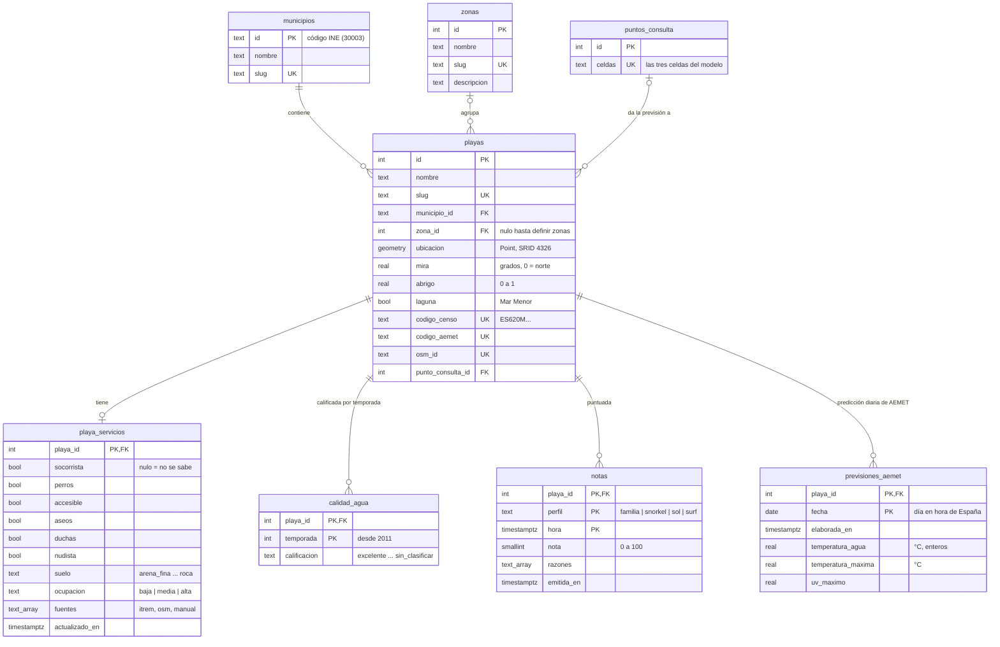
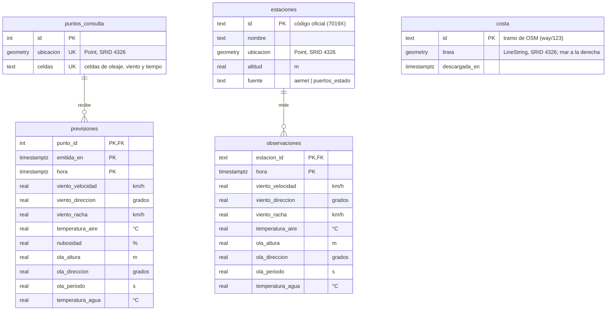

# Modelo de datos

Esquema de PostgreSQL con PostGIS. Se define en TypeScript con Drizzle (`packages/db/src/esquema/`) y se aplica con las migraciones de `packages/db/migraciones/` (`pnpm db:migrate`).

## Diagrama entidad-relación

Se muestran en dos diagramas para que se lean bien. Los une `puntos_consulta`: cada playa usa la previsión de su punto de consulta, que aparece en los dos. La costa se usa para calcular la orientación y el abrigo de las playas.

### Catálogo de playas y notas

### Previsiones, observaciones y costa

## Tablas

| Tabla               | Qué guarda                                                                                                         | Origen de los datos                                                                 | Fase |
| ------------------- | ------------------------------------------------------------------------------------------------------------------ | ----------------------------------------------------------------------------------- | ---- |
| `municipios`        | División administrativa                                                                                            | INE                                                                                 | 3    |
| `zonas`             | División que entiende la gente (Mar Menor, La Manga…), con una descripción para su página                          | `jobs/datos/zonas.json`, definidas a mano                                           | 3    |
| `playas`            | Catálogo: ubicación, orientación, abrigo, laguna                                                                   | Censo de aguas de baño; orientación, abrigo y laguna calculados con la costa de OSM | 3    |
| `playa_servicios`   | Accesible, suelo, ocupación, nudista, socorrista, perros, aseos, duchas                                            | ITREM y OpenStreetMap                                                               | 3    |
| `calidad_agua`      | Calificación oficial por temporada                                                                                 | Agencia Europea de Medio Ambiente                                                   | 3    |
| `puntos_consulta`   | Coordenadas que se piden a las APIs de previsión: una por grupo de playas que caen en las mismas celdas del modelo | Open-Meteo (`calcular:puntos`)                                                      | 4    |
| `previsiones`       | Previsión por horas de cada punto, con **todas** las emisiones                                                     | Open-Meteo                                                                          | 4    |
| `previsiones_aemet` | Predicción diaria de las playas con código de AEMET: agua, máxima y UV. Solo la última de cada día                 | AEMET (`ingerir:aemet`)                                                             | 4    |
| `notas`             | Nota vigente de cada playa por plan y hora, con sus razones                                                        | Motor de puntuación (`packages/core`)                                               | 5    |
| `estaciones`        | Estaciones y boyas que miden                                                                                       | AEMET y Puertos del Estado                                                          | 4    |
| `observaciones`     | Datos medidos por hora, comparables columna a columna con la previsión                                             | AEMET y Puertos del Estado                                                          | 4    |
| `costa`             | Línea de costa por tramos, con el mar a la derecha del sentido de la línea                                         | OpenStreetMap                                                                       | 3    |

El detalle de cada fuente está en [fuentes.md](fuentes.md).

## Decisiones de diseño

- **Previsiones por punto de consulta, no por playa.** Las playas que caen en las mismas tres celdas del modelo de Open-Meteo (oleaje, viento y temperatura) reciben exactamente la misma previsión mar adentro, así que se guarda una vez por grupo: 30 puntos para 83 playas. Lo que distingue a cada playa (laguna, orientación, abrigo) lo aplica el motor de `core` al calcular la nota.
- **Todas las emisiones.** La clave de `previsiones` incluye `emitida_en`, así que la misma hora aparece una vez por cada emisión que la predijo. Así se mide cómo cambia la previsión con la antelación.
- **Una emisión por hora de descarga.** `emitida_en` es la hora de la descarga redondeada hacia abajo, y se guardan solo las horas desde ahí en adelante (restricción `previsiones_hora_tras_emision`). Repetir la ingesta dentro de la misma hora sobrescribe esa emisión en lugar de duplicarla, y cada emisión entra entera o no entra (transacción). La hace `ingerir:previsiones` (`jobs/src/previsiones.ts`).
- **Retención: 14 días completos y después la última previsión.** Guardarlo todo ocuparía unos 1,7 GB al año con 4 descargas diarias (medido: 168 bytes por fila con índices), y Neon gratis da 0,5 GB. Durante 14 días se conservan todas las emisiones; pasado ese plazo, de cada hora solo queda la última que se hizo antes de que llegara, unos 44 MB al año. Para medir el error según la antelación en la fase 12 se usará `previous-runs` de Open-Meteo, que guarda las previsiones por antelación desde 2024.
- **Solo la nota vigente.** `notas` no guarda una nota por emisión: cada ingesta sustituye las anteriores.
- **Nulo significa desconocido.** `mira`, `abrigo` y los servicios son nulos mientras no se conocen, nunca 0 ni `false` por defecto. Así los filtros no presentan como dato lo que no lo es.
- **No se inventan playas.** Toda playa necesita un código del censo o de OpenStreetMap (restricción `playas_origen`).
- **Mismas unidades en previsión y observación.** Viento en km/h, direcciones en grados de los que viene, alturas en metros, temperaturas en °C.
- **Todo en UTC.** Las fechas son `timestamptz`; se convierten a `Europe/Madrid` solo al mostrarlas.
- **Puntos con SRID 4326.** `packages/db/src/geo.ts` define un tipo propio porque la columna `geometry` de Drizzle 0.45 ignora el SRID.

## Restricciones

Las reglas importantes están en la propia base de datos, no solo en el código:

| Tabla                          | Regla                                                                                            |
| ------------------------------ | ------------------------------------------------------------------------------------------------ |
| `municipios`                   | El id es un código INE de 5 dígitos; slug en formato URL                                         |
| `zonas`, `playas`              | Slug único en formato URL                                                                        |
| `playas`                       | `mira` entre 0 y menos de 360; `abrigo` entre 0 y 1; código del censo u OSM obligatorio          |
| `playa_servicios`              | Fuentes entre `itrem`, `osm` y `manual`; suelo y ocupación de su lista de valores                |
| `calidad_agua`                 | Calificación de la escala actual; temporada desde 2011                                           |
| `notas`                        | Perfil conocido; nota entre 0 y 100                                                              |
| `previsiones`, `observaciones` | Direcciones entre 0 y 360; velocidades, alturas y periodos no negativos; nubosidad entre 0 y 100 |
| `previsiones`                  | La hora prevista no es anterior a la emisión                                                     |
| `previsiones_aemet`            | UV no negativo                                                                                   |
| `estaciones`                   | Fuente `aemet` o `puertos_estado`                                                                |

Borrar una playa, un punto de consulta o una estación borra en cascada sus datos dependientes. Borrar un municipio o una zona con playas no está permitido.

## Índices

Además de los de las claves primarias y únicas:

| Índice                                    | Tipo   | Consulta que lo usa                        |
| ----------------------------------------- | ------ | ------------------------------------------ |
| `playas_ubicacion_idx`                    | GiST   | Playas dentro de un recuadro (mapa)        |
| `playas_ubicacion_geography_idx`          | GiST   | Playas más cercanas, en metros             |
| `playas_municipio_idx`, `playas_zona_idx` | B-tree | Páginas de municipio y de zona             |
| `puntos_consulta_ubicacion_idx`           | GiST   | Punto más cercano a cada playa             |
| `estaciones_ubicacion_idx`                | GiST   | Estación más cercana a cada zona           |
| `costa_linea_idx`                         | GiST   | Tramos de costa cercanos a cada playa      |
| `notas_ranking_idx`                       | B-tree | Ranking por plan y hora, ordenado por nota |
| `previsiones_hora_idx`                    | B-tree | Previsto frente a medido a una hora        |
| `previsiones_emitida_en_idx`              | B-tree | Última emisión y retención                 |

Para ordenar por cercanía y que se use el índice, la consulta tiene que ordenar con el operador `<->` (`ORDER BY ubicacion::geography <-> punto`), no con `ST_Distance`.
